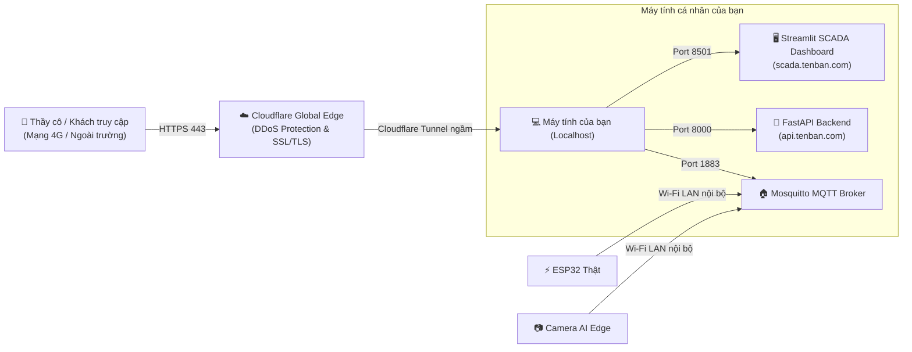

# ☁️ Hướng Dẫn Tự Host Cloud Server & Gắn Custom Domain Bằng Cloudflare Tunnel

Tài liệu này hướng dẫn chi tiết từng bước cách biến máy tính cá nhân (hoặc Mini PC / Laptop) thành một máy chủ **Cloud Server** công cộng trên Internet, sở hữu **Tên miền riêng chính chủ (Custom Domain Name)** và **chứng chỉ bảo mật SSL/HTTPS miễn phí** thông qua công nghệ **Cloudflare Tunnel (Zero Trust)** mà **không tốn chi phí thuê VPS hàng tháng** và **không cần mở cổng Modem (No Port Forwarding)**.

---

## 📑 Mục lục
1. [Tổng quan kiến trúc Self-Hosting](#1-tổng-quan-kiến-trúc-self-hosting)
2. [Yêu cầu chuẩn bị](#2-yêu-cầu-chuẩn-bị)
3. [Bước 1: Trỏ tên miền về Cloudflare](#bước-1-trỏ-tên-miền-về-cloudflare)
4. [Bước 2: Cài đặt công cụ cloudflared trên Windows](#bước-2-cài-đặt-công-cụ-cloudflared-trên-windows)
5. [Bước 3: Tạo và xác thực Tunnel](#bước-3-tạo-và-xác-thực-tunnel)
6. [Bước 4: Cấu hình Ingress Rules định tuyến Subdomain](#bước-4-cấu-hình-ingress-rules-định-tuyến-subdomain)
7. [Bước 5: Khởi chạy và thiết lập chạy ngầm cùng Windows](#bước-5-khởi-chạy-và-thiết-lập-chạy-ngầm-cùng-windows)
8. [Bước 6: Kiểm thử truy cập từ mạng ngoài (4G / Internet)](#bước-6-kiểm-thử-truy-cập-từ-mạng-ngoài-4g--internet)
9. [Chiến lược kết nối thiết bị khi Demo báo cáo](#chiến-lược-kết-nối-thiết-bị-khi-demo-báo-cáo)
10. [Xử lý sự cố thường gặp (Troubleshooting)](#xử-lý-sự-cố-thường-gặp-troubleshooting)

---

## 1. Tổng quan kiến trúc Self-Hosting



### Ưu điểm vượt trội:
* **Chi phí 0 VNĐ tiền hạ tầng:** Không cần trả phí thuê máy chủ Cloud/VPS (tiết kiệm 100.000đ – 250.000đ/tháng).
* **Vượt qua mọi rào cản mạng (CGNAT / Firewall):** Hoạt động tốt trên mạng Wi-Fi phòng trọ, Ký túc xá, trường học hoặc mạng 4G mà không cần quyền quản trị Router/Modem.
* **Bảo mật tuyệt đối:** Ẩn hoàn toàn địa chỉ IP thật của máy tính bạn. Mọi truy vấn từ Internet đều được lọc qua tường lửa của Cloudflare.
* **Tự động cấp chứng chỉ HTTPS xanh ngắt:** Chuẩn mã hóa quốc tế SSL/TLS.

---

## 2. Yêu cầu chuẩn bị

1. **Máy tính chạy hệ thống IoT:** Đã cài đặt và đang chạy sẵn các dịch vụ:
   * **FastAPI Backend:** Chạy tại `http://localhost:8000`.
   * **Streamlit Dashboard:** Chạy tại `http://localhost:8501`.
2. **Một Tên miền riêng (Domain Name):**
   * *Phương án mua giá rẻ:* Mua các đuôi `.xyz`, `.top`, `.site` trên Namecheap, Porkbun, Tenten (giá ~20k - 50k/năm).
   * *Phương án 0đ (Sinh viên VN 18-23 tuổi):* Đăng ký tên miền quốc gia `.id.vn` miễn phí 100% tại Tenten.vn, iNET.vn, hoặc PA Vietnam.
3. **Tài khoản Cloudflare:** Đăng ký miễn phí tại [dash.cloudflare.com](https://dash.cloudflare.com/).

---

## 3. Bước 1: Trỏ tên miền về Cloudflare

1. Đăng nhập vào [Cloudflare Dashboard](https://dash.cloudflare.com/).
2. Nhấn nút **Add a Domain** (Thêm tên miền) $\rightarrow$ Nhập tên miền bạn đã mua (ví dụ: `tenban.com` hoặc `tenban.id.vn`).
3. Chọn gói **Free Plan ($0)** $\rightarrow$ Nhấn **Continue**.
4. Cloudflare sẽ quét các bản ghi DNS hiện có và cung cấp cho bạn **2 địa chỉ Nameservers** (ví dụ: `eva.ns.cloudflare.com` và `walt.ns.cloudflare.com`).
5. **Cập nhật Nameserver tại nhà cung cấp tên miền:**
   * Đăng nhập vào trang quản lý nơi bạn đã mua tên miền (Tenten, iNET, Namecheap,...).
   * Tìm mục **Quản lý DNS / Đổi Nameserver (Máy chủ tên miền)**.
   * Xóa các Nameservers mặc định cũ và dán 2 địa chỉ Nameservers của Cloudflare vào $\rightarrow$ Lưu lại.
6. Quay lại Cloudflare, nhấn **Check nameservers now**. Trạng thái sẽ chuyển sang **Active** (thường từ 2 - 15 phút).

---

## 4. Bước 2: Cài đặt công cụ cloudflared trên Windows

1. **Tải file thực thi `cloudflared`:**
   * Tải bản chính thức mới nhất cho Windows 64-bit từ GitHub của Cloudflare:
     👉 [https://github.com/cloudflare/cloudflared/releases/latest/download/cloudflared-windows-amd64.msi](https://github.com/cloudflare/cloudflared/releases/latest/download/cloudflared-windows-amd64.msi) (Bộ cài đặt tự động)
   * Hoặc file `.exe` trực tiếp:
     👉 [https://github.com/cloudflare/cloudflared/releases/latest/download/cloudflared-windows-amd64.exe](https://github.com/cloudflare/cloudflared/releases/latest/download/cloudflared-windows-amd64.exe)
2. Nếu tải file `.exe`, hãy đổi tên thành `cloudflared.exe` và đặt vào thư mục `C:\Windows\System32` (hoặc thêm vào biến môi trường `PATH`) để có thể gõ lệnh ở bất kỳ đâu trong PowerShell.
3. Mở PowerShell kiểm tra:
   ```powershell
   cloudflared --version
   ```
   *Nếu hiển thị phiên bản (ví dụ: `cloudflared version 2024.x.x`) là thành công.*

---

## 5. Bước 3: Tạo và xác thực Tunnel

1. **Đăng nhập xác thực tài khoản:**
   ```powershell
   cloudflared tunnel login
   ```
   * Trình duyệt sẽ tự động bật lên trang đăng nhập Cloudflare.
   * Chọn tên miền bạn muốn kết nối $\rightarrow$ Bấm **Authorize**.
   * PowerShell sẽ thông báo: `You have successfully logged in...` và sinh ra file chứng thực tại `C:\Users\<Tên_User>\.cloudflared\cert.pem`.

2. **Khởi tạo Tunnel riêng cho dự án IoT:**
   ```powershell
   cloudflared tunnel create iot-scada-tunnel
   ```
   * Hệ thống sẽ tạo một Tunnel mới và in ra một chuỗi **Tunnel ID** (dạng mã UUID: `xxxxxxxx-xxxx-xxxx-xxxx-xxxxxxxxxxxx`).
   * Hãy ghi nhớ hoặc sao chép chuỗi **Tunnel ID** này.

---

## 6. Bước 4: Cấu hình Ingress Rules định tuyến Subdomain

### 1. Tạo file cấu hình `config.yml`
Đi tới thư mục `C:\Users\<Tên_User>\.cloudflared\` (thay `<Tên_User>` bằng tên tài khoản Windows của bạn), tạo một file mới tên là `config.yml` với nội dung như sau:

```yaml
tunnel: <ĐIỀN_TUNNEL_ID_CỦA_BẠN>
credentials-file: C:\Users\<Tên_User>\.cloudflared\<ĐIỀN_TUNNEL_ID_CỦA_BẠN>.json

ingress:
  # 1. Định tuyến Giao diện SCADA Dashboard (Port 8501)
  - hostname: scada.tenban.com
    service: http://localhost:8501
    originRequest:
      noTLSVerify: true

  # 2. Định tuyến API Backend FastAPI (Port 8000)
  - hostname: api.tenban.com
    service: http://localhost:8000

  # 3. Luật bắt buộc cuối cùng cho các truy vấn không hợp lệ
  - service: http_status:404
```
*(Thay `tenban.com` bằng tên miền chính chủ của bạn).*

### 2. Định tuyến bản ghi DNS trên Cloudflare:
Chạy 2 lệnh sau trong PowerShell để Cloudflare tự động tạo bản ghi CNAME trỏ về máy tính:
```powershell
cloudflared tunnel route dns iot-scada-tunnel scada.tenban.com
cloudflared tunnel route dns iot-scada-tunnel api.tenban.com
```

---

## 7. Bước 5: Khởi chạy và thiết lập chạy ngầm cùng Windows

### Cách 1: Chạy thử nghiệm thủ công trên Terminal
```powershell
cloudflared tunnel run iot-scada-tunnel
```
Khi terminal hiển thị: `Connection registered with Cloudflare edge...` tức là hầm kết nối đã mở thành công!

### Cách 2: Cài đặt làm Service tự chạy ngầm cùng Windows (Khuyên dùng)
Để Tunnel tự động chạy ngầm mỗi khi mở máy mà không cần bật cửa sổ terminal:
1. Mở PowerShell với quyền **Administrator** (Run as Administrator).
2. Chạy lệnh cài đặt Service:
   ```powershell
   cloudflared service install
   ```
3. Khởi động Service:
   ```powershell
   Start-Service cloudflared
   ```
*Từ bây giờ, chỉ cần máy tính bật nguồn và có mạng là đường hầm kết nối luôn sẵn sàng 24/7.*

---

## 8. Bước 6: Kiểm thử truy cập từ mạng ngoài (4G / Internet)

Hãy lấy điện thoại di động của bạn, **tắt Wi-Fi và bật mạng 4G/5G** để kiểm thử như một người dùng thực tế bên ngoài:

1. **Truy cập Dashboard SCADA:**
   * Mở trình duyệt điện thoại: `https://scada.tenban.com`
   * Kiểm tra giao diện Dashboard hiển thị đầy đủ, có **ổ khóa bảo mật HTTPS** màu xanh/xám chuẩn quốc tế.
   * Thử đăng nhập tài khoản: `admin` / `admin123`.
2. **Truy cập Backend API Docs:**
   * Mở trình duyệt: `https://api.tenban.com/docs`
   * Kiểm tra giao diện Swagger UI tương tác với các endpoint `/api/v1/logs`, `/api/v1/stats`.

---

## 9. Chiến lược kết nối thiết bị khi Demo báo cáo

Trong buổi thuyết trình, đồ án tốt nghiệp hoặc demo trước khách hàng:

```text
[Mô hình Băng chuyền & Gạt phôi]
   Camera Edge (Laptop)  ----\ 
                              +--->  Mosquitto Broker (Mạng LAN Wi-Fi: 192.168.1.x)
   ESP32 Servo Actuator  ----/       (Độ trễ < 2ms, phản hồi cơ khí tức thì)

[Giám sát từ xa toàn cầu]
   Ban Giám Khảo / Khách mời  ----->  https://scada.tenban.com (Qua 4G/Internet)
                                     (Xem số liệu nhảy theo thời gian thực)
```

* **Cơ cấu cơ khí (Camera & ESP32):** Cho kết nối trực tiếp với Mosquitto Broker thông qua địa chỉ IP mạng LAN nội bộ (`192.168.x.x`). Cách này đảm bảo **độ trễ phản hồi cơ khí siêu tốc (< 2ms)**, không bị ảnh hưởng nếu mạng Internet hội trường bị nghẽn.
* **Giao diện giám sát:** Bạn in một mã QR dẫn đến `https://scada.tenban.com`. Ban giám khảo dùng điện thoại cá nhân quét mã QR để trực tiếp theo dõi số lượng phân loại cập nhật tức thời khi vật thể chạy qua camera.

---

## 10. Xử lý sự cố thường gặp (Troubleshooting)

### Q1: Truy cập `scada.tenban.com` báo lỗi "Bad Gateway 502"?
* **Nguyên nhân:** Dịch vụ Streamlit Dashboard chưa được khởi động trên máy tính của bạn.
* **Khắc phục:** Đảm bảo bạn đã chạy `streamlit run cloud_server/dashboard/app.py` và truy cập được ở `http://localhost:8501`.

### Q2: Streamlit Dashboard bị ngắt kết nối WebSocket liên tục?
* **Khắc phục:** Trong Cloudflare Dashboard, vào **SSL/TLS** $\rightarrow$ **Edge Certificates** $\rightarrow$ Bật tính năng **WebSockets** (mặc định Cloudflare đã bật sẵn).

### Q3: Tắt máy tính thì người ngoài có truy cập được không?
* **Trả lời:** Vì bạn đang Self-Host trên máy tính cá nhân, nên máy tính phải bật và kết nối mạng thì website mới online. Khi tắt máy, người truy cập sẽ thấy màn hình thông báo chờ từ Cloudflare. Khi bạn bật máy lên lại, service sẽ tự động kết nối lại mà không cần cấu hình thêm gì.
