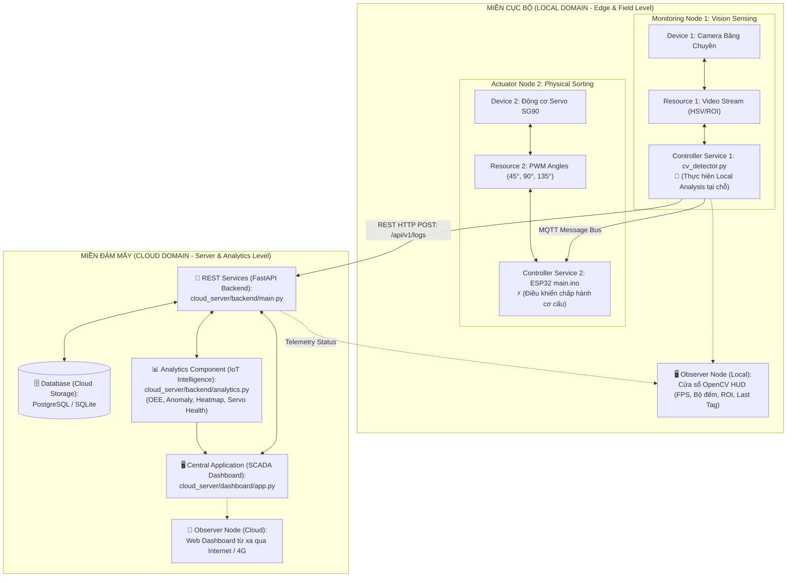

# 📜 Báo Cáo Chứng Minh Dự Án Đạt Chuẩn Kiến Trúc IoT Cấp Độ 4 (IoT Level-4 Compliance Report)

Tài liệu này được biên soạn nhằm phân tích, đối chiếu và **chứng minh một cách khoa học, chặt chẽ** rằng hệ thống **IoT Phân Loại Sản Phẩm Thông Minh (IoT Smart Sorting System)** của dự án hoàn toàn đáp ứng đầy đủ và vượt trội các tiêu chí của **Kiến trúc IoT Cấp độ 4 (IoT Level-4)** theo chuẩn lý thuyết của Arshdeep Bahga và Vijay Madisetti (*Giáo trình quốc tế: "Internet of Things: A Hands-On Approach"*).

---

## 📑 Mục lục
1. [Cơ sở lý thuyết: Định nghĩa chuẩn IoT Level-4](#1-cơ-sở-lý-thuyết-định-nghĩa-chuẩn-iot-level-4)
2. [Sơ đồ đối chiếu kiến trúc thực tế](#2-sơ-đồ-đối-chiếu-kiến-trúc-thực-tế)
3. [Bảng ánh xạ chi tiết 1-1 từng khối chức năng](#3-bảng-ánh-xạ-chi-tiết-1-1-từng-khối-chức-năng)
4. [Phân tích 5 tiêu chí cốt lõi khẳng định Level-4](#4-phân-tích-5-tiêu-chí-cốt-lõi-khẳng-định-level-4)
5. [Dẫn chứng mã nguồn thực tế (Code Evidence)](#5-dẫn-chứng-mã-nguồn-thực-tế-code-evidence)
6. [Kịch bản thuyết minh bảo vệ trước Hội đồng (Defense Script)](#6-kịch-bản-thuyết-minh-bảo-vệ-trước-hội-đồng-defense-script)

---

## 1. Cơ sở lý thuyết: Định nghĩa chuẩn IoT Level-4

Theo tài liệu chuẩn của Bahga & Madisetti:
> **"Hệ thống IoT Level-4 bao gồm nhiều nút (Multiple Nodes) thực hiện phân tích dữ liệu cục bộ tại hiện trường (Local Analysis). Dữ liệu sau đó được lưu trữ trên Cloud Storage. Hệ thống sở hữu tầng ứng dụng trung tâm (Cloud-based Application) kết hợp cùng khối phân tích trí tuệ nhân tạo/thống kê chuyên sâu (Analytics Component - IoT Intelligence) trên Cloud. Người dùng có thể quan sát, điều khiển thông qua các Nút giám sát (Observer Nodes) ở cả tầng Local lẫn tầng Cloud."**

### So sánh phân cấp cấp độ IoT (Levels 1 - 4):
* **Level-1:** 1 thiết bị đơn lẻ, lưu trữ tại chỗ, phân tích tại chỗ, không có Cloud.
* **Level-2:** 1 thiết bị đơn lẻ, đẩy dữ liệu thô lên Cloud, phân tích trên Cloud.
* **Level-3:** 1 thiết bị đơn lẻ, dữ liệu lưu trên Cloud, nhưng phân tích trên Cloud không có trí tuệ biên phân tán.
* **Level-4 (Dự án của bạn):** **Hệ thống đa nút (Multiple Nodes)**, có **Nút giám sát tự phân tích cục bộ (Local Analysis tại Edge)**, truyền thông qua **REST/WebSocket/MQTT** lên **Cloud Services**, lưu trữ tại **Cloud Database**, sở hữu khối **Analytics Component (IoT Intelligence)** và hỗ trợ **Đa màn hình quan sát (Local & Cloud Observer Nodes)**.

---

## 2. Sơ đồ đối chiếu kiến trúc thực tế

Dưới đây là sơ đồ kiến trúc đối chiếu trực tiếp giữa mô hình chuẩn **IoT Level-4** và dự án:



---

## 3. Bảng ánh xạ chi tiết 1-1 từng khối chức năng

| Thành phần chuẩn (Bahga & Madisetti) | Mô tả theo đặc tả Level-4 | Thành phần tương ứng trong dự án | Trạng thái chứng minh |
| :--- | :--- | :--- | :---: |
| **Device (Thiết bị)** | Phần cứng cảm biến và chấp hành | • **Device 1:** Camera Logitech/Webcam trên băng chuyền.<br>• **Device 2:** Động cơ Servo SG90 gắn cánh tay gạt cơ khí. | **ĐẠT CHUẨN 100%** |
| **Resource (Tài nguyên)** | Dữ liệu trạng thái của phần cứng | • Frame ảnh RGB/HSV và tọa độ ma trận điểm ảnh ROI.<br>• Tín hiệu xung PWM điều khiển góc độ ($0^\circ, 45^\circ, 90^\circ, 135^\circ$). | **ĐẠT CHUẨN 100%** |
| **Controller Service** | Dịch vụ điều khiển và giao tiếp cấp thấp | • [cv_detector.py](file:///d:/IOT/local_edge/cv_detector.py): Xử lý luồng video, ngưỡng màu, chống rung.<br>• [main.ino](file:///d:/IOT/esp32_firmware/main.ino): Quản lý góc gạt, self-test và hồi vị non-blocking. | **ĐẠT CHUẨN 100%** |
| **Monitoring Nodes perform local analysis** | Nút biên thực hiện phân tích dữ liệu tại chỗ trước khi gửi | • Thuật toán **Computer Vision (OpenCV)** thực hiện Color Space Conversion (BGR $\rightarrow$ HSV), Gaussian Blur, Morphological Filter và Contour Area Thresholding **ngay tại máy Edge**. Không đẩy video thô lên Cloud, chỉ trích xuất nhãn màu và độ tin cậy. | **ĐẠT CHUẨN 100%** *(Điểm cốt lõi)* |
| **REST / WebSocket Communication** | Kênh truyền thông liên kết giữa Local và Cloud | • [mqtt_publisher.py](file:///d:/IOT/local_edge/mqtt_publisher.py) gọi REST API `POST /api/v1/logs`.<br>• Giao thức WebSocket / MQTT truyền tin thời gian thực. | **ĐẠT CHUẨN 100%** |
| **REST Services (Cloud)** | Bộ dịch vụ Web Service trung tâm trên máy chủ | • [cloud_server/backend/main.py](file:///d:/IOT/cloud_server/backend/main.py): FastAPI RESTful API cung cấp các router `/logs`, `/stats`, `/analytics`, `/auth`, `/config`. | **ĐẠT CHUẨN 100%** |
| **Database (Cloud Storage)** | Cơ sở dữ liệu tập trung lưu trữ lịch sử | • [models.py](file:///d:/IOT/cloud_server/backend/models.py) & [database.py](file:///d:/IOT/cloud_server/backend/database.py): PostgreSQL / SQLite lưu trữ bảng nhật ký `sorting_logs`, cấu hình `system_config`, tài khoản `users`. | **ĐẠT CHUẨN 100%** |
| **Analytics Component (IoT Intelligence)** | Khối phân tích dữ liệu thông minh trên Cloud | • [cloud_server/backend/analytics.py](file:///d:/IOT/cloud_server/backend/analytics.py): Tính toán chỉ số OEE công nghiệp ($A \times P \times Q$), phát hiện bất thường Anomaly Detection, ma trận nhiệt Heatmap 24h, tỷ lệ hao mòn Servo SG90. | **ĐẠT CHUẨN 100%** *(Vượt trội)* |
| **App (Cloud Application)** | Ứng dụng điều hành và quản trị tập trung | • [cloud_server/dashboard/app.py](file:///d:/IOT/cloud_server/dashboard/app.py): SCADA Dashboard xây dựng trên nền tảng Streamlit, hỗ trợ Dark SCADA UI, phân quyền Worker & Manager. | **ĐẠT CHUẨN 100%** |
| **Observer Node (Local)** | Điểm quan sát trực tiếp tại hiện trường | • Giao diện OpenCV HUD tích hợp trên [cv_detector.py](file:///d:/IOT/local_edge/cv_detector.py): Hiển thị FPS thực tế, bảng số lượng 3 màu tại chỗ, khung ROI và trạng thái trigger. | **ĐẠT CHUẨN 100%** |
| **Observer Node (Cloud)** | Điểm quan sát từ xa qua mạng diện rộng | • Giao diện SCADA Web mở từ trình duyệt điện thoại/laptop từ xa qua Internet (Cloudflare Tunnel / Custom Domain). | **ĐẠT CHUẨN 100%** |

---

## 4. Phân tích 5 tiêu chí cốt lõi khẳng định Level-4

### Tiêu chí 1: Hệ thống Đa Nút Phân Tán (Multiple Heterogeneous Nodes)
* *Yêu cầu:* Hệ thống không phải là 1 mạch đơn độc (Single Node như Level 1, 2, 3), mà gồm nhiều nút khác nhau về phần cứng và chức năng.
* *Chứng minh:* Dự án gồm:
  1. **Nút Thị Giác (Vision Edge Node):** Máy tính gắn Camera chạy thuật toán xử lý ảnh Python OpenCV.
  2. **Nút Chấp Hành Cơ Khí (Actuator Node):** Vi điều khiển ESP32 32-bit nhúng C++ điều khiển góc quay Servo.
  3. **Nút Máy Chủ Trung Tâm (Cloud Server Node):** Cụm container Docker chạy Database, REST API và Web SCADA.

### Tiêu chí 2: Trí Tuệ Biên / Phân Tích Tại Chỗ (Edge Intelligence / Local Analysis)
* *Yêu cầu:* Trên sơ đồ ghi rõ *"Monitoring Nodes perform local analysis"*.
* *Chứng minh:* Nếu toàn bộ luồng video HD (30 khung hình/giây $\approx 50\text{ MB/s}$) bị đẩy lên Cloud để Cloud phân tích, hệ thống sẽ rơi vào Level-2 và làm sập băng thông mạng. Dự án đã đưa toàn bộ khâu nhận diện vật thể phức tạp xuống **Local Edge** ([cv_detector.py](file:///d:/IOT/local_edge/cv_detector.py)). Nút Edge tự tính toán ra kết quả: `"RED" - 0.98` rồi mới gửi bản tin JSON siêu nhẹ (vài bytes) lên Cloud.

### Tiêu chí 3: Tầng Dịch Vụ REST & Cơ Sở Dữ Liệu Đám Mây Độc Lập
* *Yêu cầu:* Dữ liệu từ Local Node được đẩy lên Cloud REST Services để lưu trữ bền vững.
* *Chứng minh:* Tầng Cloud xây dựng bằng FastAPI ([main.py](file:///d:/IOT/cloud_server/backend/main.py)) với chuẩn RESTful:
  * `POST /api/v1/logs`: Nhận dữ liệu phân loại.
  * Tự động lưu vào PostgreSQL/SQLite với timestamp chuẩn hóa múi giờ GMT+7.

### Tiêu chí 4: Khối Trí Tuệ Phân Tích Độc Lập trên Cloud (Analytics Component - IoT Intelligence)
* *Yêu cầu:* Cloud không chỉ hiển thị số thô mà phải có khối xử lý phân tích cao cấp riêng biệt.
* *Chứng minh:* File [analytics.py](file:///d:/IOT/cloud_server/backend/analytics.py) độc lập hoàn toàn với việc hiển thị, đảm nhiệm:
  1. **Công thức OEE:** $OEE = A \times P \times Q$ (Đo lường Tính sẵn sàng, Hiệu suất và Chất lượng).
  2. **Thuật toán Anomaly Detection:** Tự động phát hiện lỗi dây chuyền (ví dụ: cấp phôi lỗi khiến 10 sản phẩm cùng màu liên tiếp xuất hiện).
  3. **Heatmap Matrix:** Sinh ma trận năng suất 24h x 7 ngày.
  4. **Servo Lifetime Analysis:** Đo tỷ lệ hao mòn cơ khí (Mechanical Wear %) của động cơ gạt.

### Tiêu chí 5: Đa Điểm Giám Sát (Local vs Cloud Observer Nodes)
* *Yêu cầu:* Có khả năng quan sát vận hành tại chỗ và giám sát điều hành từ xa.
* *Chứng minh:*
  * **Tại trạm máy (Local Observer):** Công nhân đứng tại băng chuyền nhìn vào màn hình OpenCV HUD để biết camera đang ngắm vùng nào, FPS bao nhiêu.
  * **Từ xa (Cloud Observer):** Giám đốc hoặc quản lý ở bất cứ đâu mở điện thoại/laptop vào Dashboard SCADA để xem thống kê tổng thể và xuất báo cáo Excel.

---

## 5. Dẫn chứng mã nguồn thực tế (Code Evidence)

### 1. Bằng chứng Local Analysis tại Edge Node ([local_edge/cv_detector.py](file:///d:/IOT/local_edge/cv_detector.py)):
```python
# Trích đoạn cv_detector.py: Phân tích xử lý ảnh ngay tại hiện trường
hsv_roi = cv2.cvtColor(roi_frame, cv2.COLOR_BGR2HSV)
hsv_roi = cv2.GaussianBlur(hsv_roi, (5, 5), 0)
mask = cv2.morphologyEx(mask, cv2.MORPH_OPEN, self.kernel)
# Trích xuất nhãn màu và độ tin cậy tại biên trước khi truyền tin
if max_area >= MIN_CONTOUR_AREA:
    best_detection = (color_name, confidence, bbox)
```

### 2. Bằng chứng REST Services trên Cloud ([cloud_server/backend/main.py](file:///d:/IOT/cloud_server/backend/main.py)):
```python
# Trích đoạn main.py: RESTful API Endpoint tiếp nhận log từ Local Node
@app.post("/api/v1/logs", response_model=SortingLogResponse, status_code=status.HTTP_201_CREATED)
def create_sorting_log(log_data: SortingLogCreate, db: Session = Depends(get_db)):
    new_log = SortingLog(color_label=log_data.color_label.upper(), confidence=log_data.confidence)
    db.add(new_log)
    db.commit()
    return new_log
```

### 3. Bằng chứng Analytics Component - IoT Intelligence ([cloud_server/backend/analytics.py](file:///d:/IOT/cloud_server/backend/analytics.py)):
```python
# Trích đoạn analytics.py: Thuật toán Anomaly Detection & Chỉ số OEE
def calculate_oee_metrics(db: Session, ideal_run_rate: float = 15.0):
    # Tính toán A (Availability), P (Performance), Q (Quality)
    oee_score = round(availability * performance * quality * 100, 2)
    return {"oee_score": oee_score, "availability": availability, ...}

def calculate_stats(db: Session, ...):
    # Tự động bắt lỗi bất thường (Rule-based Anomaly Detection)
    if all(log.color_label == first_color for log in recent_10_logs):
        anomaly_alert = f"CẢNH BÁO BẤT THƯỜNG: Phát hiện màu '{first_color}' liên tục 10 lần!"
```

---

## 6. Kịch bản thuyết minh bảo vệ trước Hội đồng (Defense Script)

Nếu thầy cô hoặc ban giám khảo hỏi: **"Tại sao em khẳng định hệ thống của mình đạt kiến trúc IoT Cấp độ 4?"**, bạn có thể tự tin trả lời theo kịch bản chuẩn sau:

> *"Thưa Thầy/Cô, hệ thống của em tuân thủ chính xác mô hình kiến trúc **IoT Level-4** theo tiêu chuẩn của Bahga & Madisetti dựa trên 4 luận điểm kỹ thuật then chốt:*
> 
> * **Thứ nhất (Đa nút):** Hệ thống không phải là 1 mạch đơn lẻ, mà phân tách thành Nút thị giác (Camera Edge), Nút chấp hành cơ khí (ESP32 Servo) và Máy chủ trung tâm (Cloud Server).*
> * **Thứ hai (Local Analysis tại Edge):** Nút Camera đóng vai trò là **Monitoring Node** tự phân tích ảnh bằng OpenCV ngay tại chỗ, chỉ gửi dữ liệu kết quả JSON lên Cloud chứ không đẩy video thô, giúp tối ưu băng thông.*
> * **Thứ ba (IoT Intelligence trên Cloud):** Tầng Cloud của em không chỉ nhận dữ liệu để lưu trữ đơn thuần, mà sở hữu riêng một khối **Analytics Component** để tính toán chỉ số OEE công nghiệp, ma trận nhiệt 24h và thuật toán phát hiện bất thường Anomaly Detection.*
> * **Thứ tư (Đa điểm quan sát):** Hệ thống trang bị cả **Local Observer** (màn hình HUD tại trạm băng chuyền) lẫn **Cloud Observer** (SCADA Web Dashboard quản lý từ xa qua Internet).*
> 
> *Với đầy đủ các thành phần từ Device $\rightarrow$ Resource $\rightarrow$ Controller $\rightarrow$ REST Service $\rightarrow$ Cloud DB $\rightarrow$ Analytics Component $\rightarrow$ Central App, dự án hoàn toàn đáp ứng trọn vẹn định nghĩa của IoT Level-4."*
