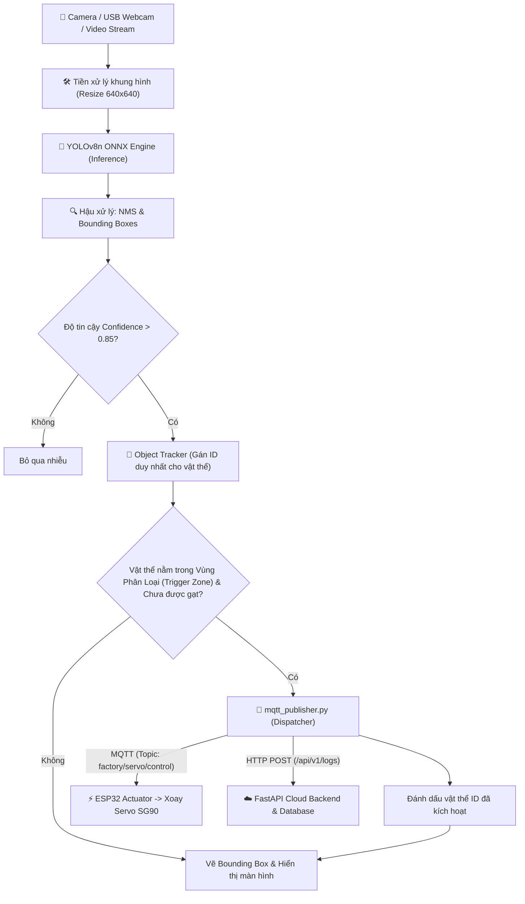

# 🚀 Kế Hoạch Phát Triển Giai Đoạn 2: Tích Hợp Deep Learning & Computer Vision Tại Local Edge
*(Phase 2 Development Plan: Edge AI Vision & Object Detection for Smart Sorting)*

---

## 📑 Mục lục
1. [Bối cảnh & Mục tiêu dự án](#1-bối-cảnh--mục-tiêu-dự-án)
2. [So sánh kiến trúc: Giai đoạn 1 (HSV) vs Giai đoạn 2 (Deep Learning)](#2-so-sánh-kiến-trúc-giai-đoạn-1-hsv-vs-giai-đoạn-2-deep-learning)
3. [Lựa chọn kiến trúc mô hình AI](#3-lựa-chọn-kiến-trúc-mô-hình-ai)
4. [Sơ đồ luồng dữ liệu thời gian thực (Real-time Pipeline)](#4-sơ-đồ-luồng-dữ-liệu-thời-gian-thực-real-time-pipeline)
5. [Lộ trình triển khai chi tiết (Milestones)](#5-lộ-trình-triển-khai-chi-tiết-milestones)
   - [Milestone 1: Thu thập & Đóng gói dữ liệu (Data Pipeline)](#milestone-1-thu-thập--đóng-gói-dữ-liệu-data-pipeline)
   - [Milestone 2: Huấn luyện & Đánh giá mô hình (Model Training)](#milestone-2-huấn-luyện--đánh-giá-mô-hình-model-training)
   - [Milestone 3: Tối ưu hóa suy luận & Cơ chế Tracking (Edge Inference Engine)](#milestone-3-tối-ưu-hóa-suy-luận--cơ-chế-tracking-edge-inference-engine)
   - [Milestone 4: Kiểm thử tích hợp toàn chuỗi (End-to-End Integration)](#milestone-4-kiểm-thử-tích-hợp-toàn-chuỗi-end-to-end-integration)
6. [Cấu trúc mã nguồn Local Edge dự kiến](#6-cấu-trúc-mã-nguồn-local-edge-dự-kiến)
7. [Tiêu chuẩn đánh giá nghiệm thu (KPIs & Acceptance Criteria)](#7-tiêu-chuẩn-đánh-giá-nghiệm-thu-kpis--acceptance-criteria)
8. [Quản trị rủi ro & Phương án dự phòng (Fallback Strategy)](#8-quản-trị-rủi-ro--phương-án-dự-phòng-fallback-strategy)

---

## 1. Bối cảnh & Mục tiêu dự án

Trong **Giai đoạn 1**, hệ thống đã vận hành thành công luồng xử lý cục bộ sử dụng thuật toán **Computer Vision truyền thống (Color Masking trong không gian màu HSV)** kết hợp cùng vùng nhận diện **ROI (Region of Interest)**.

Tuy nhiên, trong môi trường công nghiệp thực tế:
- Ánh sáng tự nhiên và đèn nhà xưởng liên tục thay đổi (gây biến thiên thông số Hue, Saturation, Value).
- Bóng đổ (shadows) và hiện tượng phản chiếu ánh sáng bề mặt (specular reflection) dễ gây nhiễu nhận diện màu.
- Dị vật ngoại lai (bàn tay công nhân, bụi bẩn, băng chuyền xước) có thể kích hoạt nhầm cơ cấu chấp hành.

**Mục tiêu của Giai đoạn 2:**
1. Nâng cấp bộ não phân tích thị giác tại **Local Edge Node** lên mô hình **Deep Learning (Object Detection)** có khả năng học đặc trưng hình học, bề mặt và màu sắc của sản phẩm.
2. Đạt độ chính xác nhận diện $\ge 95\%$ trong nhiều điều kiện chiếu sáng khác nhau.
3. Đảm bảo tốc độ suy luận (Inference Speed) đạt từ **30 đến 60 FPS** trực tiếp trên CPU/Edge Device.
4. Bổ sung cơ chế **Object Tracking (Định danh vật thể)** nhằm khắc phục triệt để hiện tượng gửi lệnh phân loại trùng lặp khi sản phẩm di chuyển qua camera.

---

## 2. So sánh kiến trúc: Giai đoạn 1 (HSV) vs Giai đoạn 2 (Deep Learning)

| Tiêu chí | Giai đoạn 1: OpenCV HSV Masking | Giai đoạn 2: Deep Learning Object Detection |
| :--- | :--- | :--- |
| **Bản chất thuật toán** | Heuristic, dựa trên ngưỡng màu cố định | Mạng nơ-ron học sâu tích chập (CNN / Feature Pyramid) |
| **Khả năng chịu nhiễu sáng** | Kém (dễ bắt sai khi đổi bóng đèn, ánh sáng mặt trời) | Rất cao (mô hình học đặc trưng tổng quát hóa) |
| **Nhận diện hình dạng** | Hạn chế (chỉ đếm pixel diện tích contour) | Bounding Box chính xác vị trí và hình dạng từng vật thể |
| **Phân biệt dị vật** | Không (vật gì có màu Đỏ/Vàng/Xanh đều bị bắt) | Tốt (chỉ kích hoạt với sản phẩm đúng hình dạng đào tạo) |
| **Độ tin cậy (Confidence)** | Ước lượng thô theo tỷ lệ pixel | Trọng số xác suất toán học rõ ràng ($0.00 \to 1.00$) |
| **Theo dõi liên tục (Tracking)**| Phải tự code thủ công theo vị trí contour | Tích hợp dễ dàng thuật toán ByteTrack / Centroid Tracking |

---

## 3. Lựa chọn kiến trúc mô hình AI

Dựa trên yêu cầu vận hành cận biên (Edge Computing) với độ trễ thấp và tài nguyên phần cứng tối ưu:

| Kiến trúc | Kích thước Model | FPS (CPU Core i5/i7) | mAP@50 | Đánh giá lựa chọn |
| :--- | :--- | :--- | :--- | :--- |
| **YOLOv8n (Nano)** | **~6.2 MB** | **35 - 55 FPS** | **~96.5%** | **LỰA CHỌN TỐI ƯU NHẤT** (Nhẹ, cực nhanh, độ chính xác cao) |
| **YOLO11n (Nano)** | ~5.6 MB | 38 - 60 FPS | ~97.0% | Phương án nâng cao kế thừa từ Ultralytics |
| **MobileNetV2-SSD** | ~15.0 MB | 25 - 35 FPS | ~91.0% | Khá tốt nhưng pipeline huấn luyện phức tạp hơn YOLO |
| **ResNet-18 (Classification)**| ~45.0 MB | 20 - 30 FPS | - | Chỉ phân loại ảnh, không xuất được Bounding Box tọa độ |

👉 **Quyết định kỹ thuật:** Lựa chọn **YOLOv8 Nano (`yolov8n.pt`)** do cộng đồng hỗ trợ mạnh, dễ export sang định dạng **ONNX/OpenVINO** để tối ưu hóa tăng tốc CPU.

---

## 4. Sơ đồ luồng dữ liệu thời gian thực (Real-time Pipeline)



---

## 5. Lộ trình triển khai chi tiết (Milestones)

### Milestone 1: Thu thập & Đóng gói dữ liệu (Data Pipeline)
*Thời lượng dự kiến: 1 - 2 ngày*
1. **Phát triển script thu thập dữ liệu tự động (`local_edge/collect_dataset.py`):**
   - Đọc luồng video trực tiếp từ webcam.
   - Nhấn phím cách (`SPACE`) hoặc tự động chụp định kỳ mỗi 0.5s khi phát hiện chuyển động.
   - Lưu ảnh chất lượng cao vào thư mục `datasets/raw/`.
2. **Kịch bản thu thập mẫu (Sampling Diversity):**
   - Chụp 3 nhóm sản phẩm: `red_box`, `yellow_box`, `green_box`.
   - Đa dạng hóa góc chụp: trực diện, nghiêng $30^\circ$, nghiêng $45^\circ$, khoảng cách gần/xa.
   - Đa dạng hóa chiếu sáng: đủ sáng, thiếu sáng, bật đèn flash, ánh sáng tự nhiên.
   - Số lượng mục tiêu: **200 - 300 ảnh/nhóm** (Tổng: 600 - 900 ảnh).
3. **Gán nhãn (Data Annotation):**
   - Sử dụng công cụ **Roboflow** hoặc **LabelImg**.
   - Định dạng gán nhãn: YOLO format (`class_id x_center y_center width height`).
   - Danh sách 3 nhãn:
     - `0: RED`
     - `1: YELLOW`
     - `2: GREEN`
4. **Data Augmentation:**
   - Tạo biến thể tự động: Lật ngang (Horizontal Flip), xoay nhẹ $\pm 10^\circ$, điều chỉnh độ sáng $\pm 20\%$.
   - Xuất bộ dữ liệu chuẩn: Chia tỷ lệ `Train (70%) - Val (20%) - Test (10%)`.

---

### Milestone 2: Huấn luyện & Đánh giá mô hình (Model Training)
*Thời lượng dự kiến: 1 ngày*
1. **Thiết lập file cấu hình huấn luyện `datasets/data.yaml`:**
   ```yaml
   path: ./datasets
   train: images/train
   val: images/val
   test: images/test
   names:
     0: RED
     1: YELLOW
     2: GREEN
   ```
2. **Quy trình huấn luyện (`local_edge/train.py`):**
   - Chạy trên Google Colab (GPU NVIDIA T4) hoặc GPU máy cục bộ.
   - Tham số huấn luyện:
     - Model: `yolov8n.pt` (Pretrained weights từ COCO để Transfer Learning).
     - Image size: `640x640`.
     - Batch size: `16`.
     - Epochs: `60 - 100`.
     - Optimizer: `AdamW` (learning rate: $0.001$).
3. **Đánh giá chất lượng mô hình:**
   - $mAP_{50} \ge 0.95$ trên tập Validation.
   - Phân tích biểu đồ **Confusion Matrix** để đảm bảo không bị nhầm lẫn giữa màu Đỏ và Vàng khi ánh sáng yếu.
   - Lưu trọng số tốt nhất vào `local_edge/models/best.pt`.

---

### Milestone 3: Tối ưu hóa suy luận & Cơ chế Tracking (Edge Inference Engine)
*Thời lượng dự kiến: 2 ngày*
1. **Xuất mô hình tối ưu cho CPU (Model Export):**
   - Chuyển đổi trọng số từ PyTorch (`.pt`) sang định dạng **ONNX** hoặc **OpenVINO**:
     ```bash
     yolo export model=local_edge/models/best.pt format=onnx simplify=True
     ```
   - Định dạng ONNX giúp loại bỏ phụ thuộc nặng nề của PyTorch trên môi trường Edge và tăng tốc độ xử lý thêm $40\% - 60\%$.
2. **Cập nhật mã nguồn `cv_detector.py`:**
   - Xây dựng class `YoloSortingDetector` sử dụng OpenCV DNN hoặc thư viện `ultralytics`.
   - Đọc cài đặt qua biến môi trường `.env`:
     ```env
     DETECTOR_BACKEND=YOLO          # Tùy chọn: YOLO hoặc HSV
     MODEL_PATH=models/best.onnx
     CONFIDENCE_THRESHOLD=0.85
     ```
3. **Tích hợp giải thuật Object Tracking & Debounce:**
   - Sử dụng **Centroid Tracker** tính toán tâm hình chữ nhật của từng Bounding Box qua các khung hình liên tiếp.
   - Gán `Track_ID` cho mỗi sản phẩm.
   - Quy định **Vạch Kích Hoạt (Trigger Line)** ở giữa màn hình. Chỉ khi tâm sản phẩm cắt ngang vạch kích hoạt thì mới phát lệnh điều khiển một lần duy nhất.

---

### Milestone 4: Kiểm thử tích hợp toàn chuỗi (End-to-End Integration)
*Thời lượng dự kiến: 1 ngày*
1. **Đo đạc độ trễ toàn chuỗi (Latency Benchmarking):**
   - Thời gian suy luận AI: $\le 25\text{ ms}$.
   - Thời gian gửi bản tin MQTT tới broker: $\le 10\text{ ms}$.
   - Thời gian ESP32 nhận lệnh và xoay Servo SG90: $\le 50\text{ ms}$.
   - Tổng độ trễ phản hồi: $\le 85\text{ ms}$ (đáp ứng tốt băng chuyền di chuyển tốc độ công nghiệp).
2. **Kiểm thử tình huống bất thường (Edge Cases):**
   - Đưa bàn tay hoặc đồ vật màu xanh/đỏ khác (áo, bút) vào khung hình $\rightarrow$ Mô hình phải bỏ qua vì không đúng hình dạng sản phẩm được huấn luyện.
   - Thử nghiệm tắt đèn/bật đèn thay đổi đột ngột $\rightarrow$ Tỷ lệ nhận diện đúng vẫn giữ vững $\ge 90\%$.
3. **Đồng bộ dữ liệu Cloud:**
   - Xác nhận mọi bản ghi nhận diện từ model YOLO đều được ghi log đầy đủ vào Database và hiển thị chuẩn xác trên Streamlit SCADA Dashboard.

---

## 6. Cấu trúc mã nguồn Local Edge dự kiến

Sau khi hoàn thành Giai đoạn 2, thư mục `local_edge/` sẽ có cấu trúc chuyên nghiệp như sau:

```text
local_edge/
├── config.py                 # Cấu hình Camera, Model Path, Thresholds, MQTT, API
├── cv_detector.py            # Module nhận diện hỗ trợ cả YOLO (chính) & HSV (fallback)
├── mqtt_publisher.py         # Module điều phối bản tin MQTT & Cloud REST API
├── tracker.py                # [MỚI] Module Centroid Tracker gán ID cho vật thể
├── collect_dataset.py        # [MỚI] Tool thu thập ảnh mẫu tự động từ Camera
├── train.py                  # [MỚI] Script huấn luyện mô hình YOLOv8
├── requirements.txt          # Cập nhật thêm ultralytics, onnx, onnxruntime
├── models/                   # [MỚI] Thư mục chứa trọng số đã huấn luyện
│   ├── best.pt               # Trọng số gốc PyTorch
│   ├── best.onnx             # Trọng số tối ưu hóa cho Edge CPU
│   └── .gitkeep
└── datasets/                 # [MỚI] Thư mục chứa dữ liệu đào tạo (Thêm vào .gitignore)
    ├── data.yaml             # Đặc tả tập dữ liệu YOLO
    ├── images/               # Thư mục ảnh (train, val, test)
    └── labels/               # Thư mục nhãn annotations tương ứng
```

---

## 7. Tiêu chuẩn đánh giá nghiệm thu (KPIs & Acceptance Criteria)

| Chỉ số (Metric) | Tiêu chuẩn nghiệm thu (Acceptance Criteria) |
| :--- | :--- |
| **Độ chính xác mô hình ($mAP_{50}$)** | $\ge 95.0\%$ trên tập kiểm thử độc lập |
| **Tốc độ khung hình (FPS)** | $\ge 30\text{ FPS}$ ổn định trên CPU máy tính |
| **Tỷ lệ nhận diện sai màu** | $< 2.0\%$ trong điều kiện ánh sáng phòng bình thường |
| **Tỷ lệ nhận diện nhầm dị vật** | $< 1.0\%$ (bàn tay, nền băng chuyền không bị nhận dạng) |
| **Tỷ lệ kích hoạt trùng (Duplicate Trigger)**| $0\%$ (nhờ thuật toán Object Tracking gán ID) |
| **Độ ổn định hệ thống** | Chạy liên tục 30 phút không bị tràn bộ nhớ RAM (Memory Leak) |

---

## 8. Quản trị rủi ro & Phương án dự phòng (Fallback Strategy)

1. **Rủi ro 1: Máy tính không có GPU rời, việc huấn luyện mô hình bị chậm:**
   - *Phương án:* Sử dụng môi trường **Google Colab miễn phí** có sẵn GPU NVIDIA T4, toàn bộ quá trình train chỉ mất khoảng 15 phút. Sau đó tải file `best.pt` về máy.
2. **Rủi ro 2: CPU máy Edge yếu, FPS dưới 20 khi chạy model PyTorch:**
   - *Phương án:* Chuyển đổi sang runtime **ONNX Runtime** với cờ tối ưu hóa OpenVINO hoặc giảm kích thước ảnh đầu vào từ `640x640` xuống `416x416` hoặc `320x320`.
3. **Rủi ro 3: File model hoặc thư viện AI gặp lỗi môi trường khi khởi động:**
   - *Phương án:* Trong `cv_detector.py` luôn duy trì cơ chế **Dual-Engine Fallback**. Nếu không load được file model ONNX, hệ thống sẽ tự động in cảnh báo và lùi về chế độ lọc màu HSV của Giai đoạn 1 để đảm bảo băng chuyền không bao giờ bị dừng gián đoạn.
