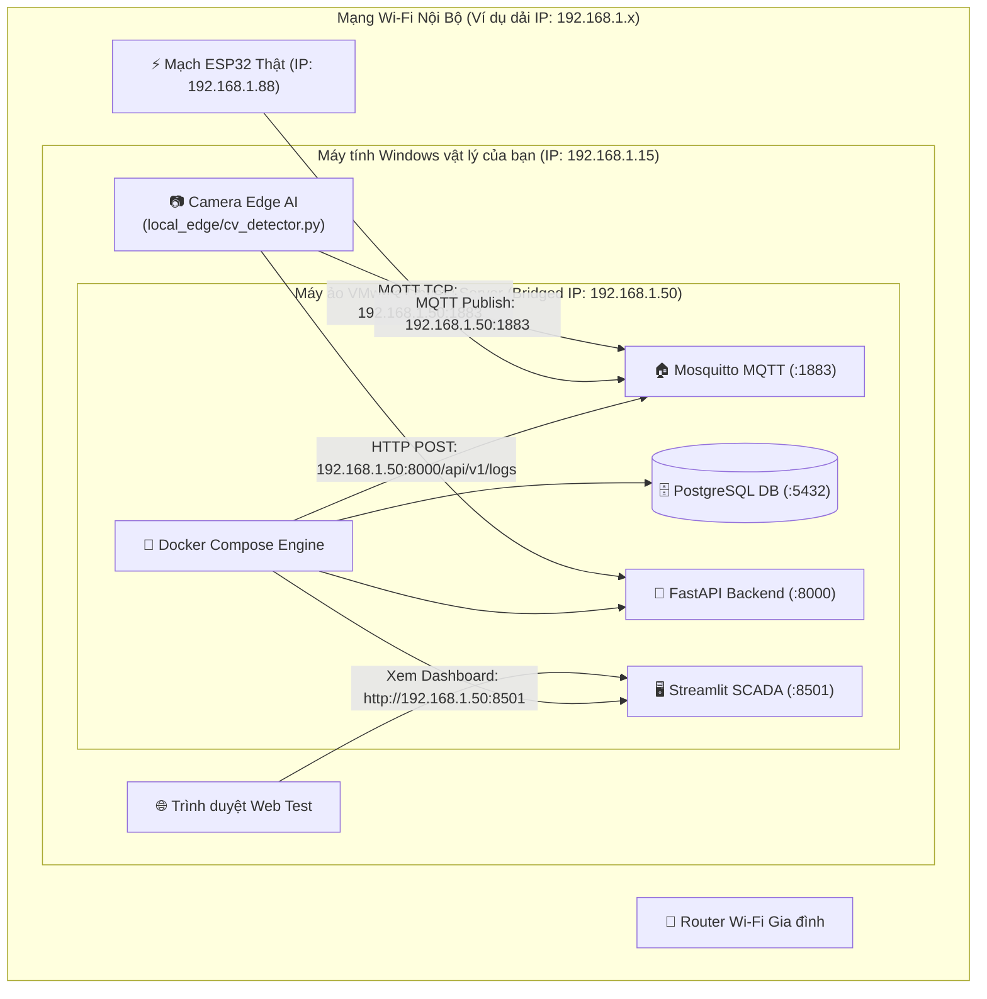

# 🐧 Hướng Dẫn Triển Khai Cloud Server Trên Máy Ảo VMware Ubuntu Server

Tài liệu này hướng dẫn chi tiết từng bước cách dựng một máy chủ **Ubuntu Server 22.04 / 24.04 LTS** trên phần mềm ảo hóa **VMware Workstation**, sau đó triển khai toàn bộ cụm dịch vụ **Cloud Server (PostgreSQL + Mosquitto + FastAPI + Streamlit Dashboard)** để biến máy ảo thành một **Server Homelab** độc lập, an toàn và chuẩn công nghiệp.

---

## 📑 Mục lục
1. [Mô hình kiến trúc mạng VMware Homelab](#1-mô-hình-kiến-trúc-mạng-vmware-homelab)
2. [Yêu cầu chuẩn bị](#2-yêu-cầu-chuẩn-bị)
3. [Bước 1: Tạo máy ảo và cấu hình mạng Bridged Network](#bước-1-tạo-máy-ảo-và-cấu-hình-mạng-bridged-network)
4. [Bước 2: Cài đặt Docker & Docker Compose trên Ubuntu](#bước-2-cài-đặt-docker--docker-compose-trên-ubuntu)
5. [Bước 3: Sao chép mã nguồn cloud_server vào máy ảo](#bước-3-sao-chép-mã-nguồn-cloud_server-vào-máy-ảo)
6. [Bước 4: Khởi chạy hệ sinh thái Cloud bằng Docker Compose](#bước-4-khởi-chạy-hệ-sinh-thái-cloud-bằng-docker-compose)
7. [Bước 5: Kết nối thiết bị thực tế (ESP32, Camera Edge, Web)](#bước-5-kết-nối-thiết-bị-thực-tế-esp32-camera-edge-web)
8. [Bước 6: Tích hợp Cloudflare Tunnel trên Ubuntu (Tùy chọn ra Internet)](#bước-6-tích-hợp-cloudflare-tunnel-trên-ubuntu-tùy-chọn-ra-internet)
9. [Mẹo vận hành & Sao lưu chuyên nghiệp (Snapshot)](#mẹo-vận-hành--sao-lưu-chuyên-nghiệp-snapshot)
10. [Xử lý lỗi thường gặp (Troubleshooting)](#xử-lý-lỗi-thường-gặp-troubleshooting)

---

## 1. Mô hình kiến trúc mạng VMware Homelab



### Điểm mấu chốt của mô hình:
* **Chế độ mạng Cầu nối (Bridged Network):** Máy ảo Ubuntu không bị giấu sau máy Windows, mà nhận trực tiếp **1 địa chỉ IP riêng biệt từ Router Wi-Fi** (ví dụ: `192.168.1.50`).
* **Độc lập hoàn toàn:** ESP32 và Camera truyền thẳng vào IP của máy ảo như một chiếc máy chủ vật lý thật ngoài đời.
* **Cách ly an toàn:** Windows chính của bạn không bị mở port, không bị nguy cơ bảo mật nếu có lỗ hổng.

---

## 2. Yêu cầu chuẩn bị

1. **Phần mềm VMware:**
   * Cài đặt **VMware Workstation Pro** (Broadcom hiện đã miễn phí cho người dùng cá nhân) hoặc **VMware Workstation Player**.
2. **File ISO Ubuntu Server:**
   * Tải file `.iso` bản **Ubuntu Server 22.04 LTS** hoặc **24.04 LTS** (Bản Server không có giao diện đồ họa GUI, ăn cực ít RAM):
     👉 [https://ubuntu.com/download/server](https://ubuntu.com/download/server)
3. **Cấu hình phần cứng khuyến nghị cho máy ảo:**
   * **RAM:** 2 GB đến 4 GB (Đủ chạy mượt cả 4 container Docker).
   * **CPU:** 2 Cores (vCPU).
   * **Ổ cứng:** 25 GB - 30 GB (Dạng dung lượng co giãn - Split virtual disk).

---

## 3. Bước 1: Tạo máy ảo và cấu hình mạng Bridged Network

### 1. Tạo máy ảo mới trong VMware:
1. Mở VMware $\rightarrow$ Chọn **Create a New Virtual Machine** $\rightarrow$ Chọn **Typical (recommended)**.
2. Tại mục *Guest-OS Installation*, chọn **Installer disc image file (iso)** và trỏ tới file ISO Ubuntu vừa tải.
3. Đặt thông tin tài khoản người dùng máy ảo:
   * *Full name:* `IoT Admin`
   * *Username:* `iotadmin` (hoặc tên bạn muốn, viết liền không dấu)
   * *Password:* Đặt mật khẩu bạn dễ nhớ (ví dụ: `123456`).
4. Phân bổ tài nguyên: CPU: `2 Cores`, RAM: `2048 MB` (2GB) hoặc `4096 MB` (4GB), Ổ cứng: `30 GB`.

### 2. CẤU HÌNH BẮT BUỘC: Chuyển Card mạng sang Bridged Network
> [!IMPORTANT]
> Mặc định VMware sẽ chọn mạng NAT. Bạn **phải đổi sang Bridged** để ESP32 cùng Wi-Fi nhìn thấy máy ảo!

1. Nhấp chuột phải vào tên máy ảo $\rightarrow$ Chọn **Settings...**
2. Chọn thẻ **Network Adapter** ở cột trái.
3. Tích chọn **Bridged: Connected directly to the physical network**.
4. Tích thêm vào ô: **Replicate physical network connection state**.
5. Nhấn **OK**.

### 3. Cài đặt Ubuntu Server:
* Bật nguồn máy ảo (Power on).
* Trong quá trình cài đặt bằng văn bản, cứ nhấn **Done** theo mặc định.
* Ở bước *Featured Server Snaps*, bạn có thể tích chọn luôn **docker** nếu có, hoặc để cài bằng lệnh sau.
* Sau khi cài xong, khởi động lại và đăng nhập bằng tài khoản `iotadmin` đã tạo.

---

## 4. Bước 2: Cài đặt Docker & Docker Compose trên Ubuntu

Sau khi đăng nhập vào terminal màu đen của Ubuntu, chạy các lệnh sau:

### 1. Cập nhật hệ thống & cài các công cụ cần thiết:
```bash
sudo apt update && sudo apt upgrade -y
sudo apt install -y curl git ufw net-tools ca-certificates gnupg lsb-release
```

### 2. Cài đặt Docker Engine chính thức:
```bash
# Thêm khóa GPG chính thức của Docker
sudo install -m 0755 -d /etc/apt/keyrings
curl -fsSL https://download.docker.com/linux/ubuntu/gpg | sudo gpg --dearmor -o /etc/apt/keyrings/docker.gpg
sudo chmod a+r /etc/apt/keyrings/docker.gpg

# Thêm kho lưu trữ Docker vào APT
echo "deb [arch=$(dpkg --print-architecture) signed-by=/etc/apt/keyrings/docker.gpg] https://download.docker.com/linux/ubuntu $(lsb_release -cs) stable" | sudo tee /etc/apt/sources.list.d/docker.list > /dev/null

# Cài đặt Docker và Docker Compose Plugin
sudo apt update
sudo apt install -y docker-ce docker-ce-cli containerd.io docker-buildx-plugin docker-compose-plugin
```

### 3. Cho phép chạy Docker không cần gõ `sudo`:
```bash
sudo usermod -aG docker $USER
newgrp docker
```
*Kiểm tra:* Gõ lệnh `docker compose version`, nếu in ra phiên bản (ví dụ: `Docker Compose version v2.x.x`) là thành công!

---

## 5. Bước 3: Sao chép mã nguồn cloud_server vào máy ảo

Bạn có thể đưa thư mục dự án lên Ubuntu theo **1 trong 2 cách**:

### Cách 1: Dùng Git (Đơn giản nhất nếu code đã đẩy lên GitHub)
```bash
cd ~
git clone https://github.com/<tai_khoan_cua_ban>/<ten_repo>.git iot-project
cd iot-project/cloud_server
```

### Cách 2: Sao chép trực tiếp từ Windows sang Ubuntu qua SCP / FileZilla
1. Trên Ubuntu, lấy địa chỉ IP bằng lệnh:
   ```bash
   hostname -I
   ```
   *(Giả sử in ra: `192.168.1.50`)*
2. Mở PowerShell trên Windows, di chuyển vào thư mục dự án và bắn thư mục `cloud_server` sang máy ảo:
   ```powershell
   scp -r d:\IOT\cloud_server iotadmin@192.168.1.50:~/
   ```
   *(Nhập mật khẩu máy ảo Ubuntu khi được hỏi).*

---

## 6. Bước 4: Khởi chạy hệ sinh thái Cloud bằng Docker Compose

Trên máy ảo Ubuntu, di chuyển vào thư mục `cloud_server`:
```bash
cd ~/cloud_server
```

### 1. Đảm bảo cấu hình Mosquitto phân quyền đúng:
Trên Linux, thư mục config của Mosquitto cần cấp quyền đọc:
```bash
chmod -R 755 mosquitto/config/
```

### 2. Khởi động toàn bộ 4 dịch vụ bằng 1 lệnh duy nhất:
```bash
docker compose up -d --build
```

### 3. Kiểm tra trạng thái các Container:
```bash
docker compose ps
```
Nếu màn hình hiển thị cả 4 container đều ở trạng thái `Up` hoặc `running`:
* `iot_mosquitto_broker` (Port `1883`, `9001`)
* `iot_postgres_db` (Port `5432`)
* `iot_backend_api` (Port `8000`)
* `iot_dashboard_ui` (Port `8501`)
👉 **Chúc mừng bạn, máy chủ Cloud Server trên máy ảo Ubuntu đã vận hành hoàn hảo!**

---

## 7. Bước 5: Kết nối thiết bị thực tế (ESP32, Camera Edge, Web)

Tìm địa chỉ IP chính xác của máy ảo Ubuntu:
```bash
hostname -I
```
*(Giả sử IP máy ảo là: **`192.168.1.50`**)*

### 1. Truy cập Web Dashboard từ máy tính Windows:
* Mở Chrome trên Windows, gõ: `http://192.168.1.50:8501` $\rightarrow$ Giao diện SCADA Dashboard sẽ hiện ra tức thì!
* Mở Swagger API: `http://192.168.1.50:8000/docs`

### 2. Cấu hình Mạch ESP32 Thật ([esp32_firmware/main.ino](file:///d:/IOT/esp32_firmware/main.ino)):
Đổi thông số Broker trỏ về IP của máy ảo:
```cpp
const char* MQTT_BROKER = "192.168.1.50";  // Điền đúng IP máy ảo Ubuntu
const int   MQTT_PORT = 1883;
```
Nạp code vào ESP32, mở Serial Monitor kiểm tra thông báo kết nối thành công.

### 3. Cấu hình Local Edge Detector ([local_edge/config.py](file:///d:/IOT/local_edge/config.py)):
Trong file `.env` hoặc `config.py` trên Windows:
```python
MQTT_BROKER = "192.168.1.50"
API_BASE_URL = "http://192.168.1.50:8000"
```
Chạy `python local_edge/cv_detector.py` $\rightarrow$ Tín hiệu nhận diện sẽ được bắn trực tiếp vào máy ảo Ubuntu!

---

## 8. Bước 6: Tích hợp Cloudflare Tunnel trên Ubuntu (Tùy chọn ra Internet)

Nếu sau này bạn mua domain và muốn mở máy ảo này ra toàn cầu mà vẫn giữ an toàn 100%:

1. Cài đặt `cloudflared` trực tiếp trên Ubuntu Server:
   ```bash
   curl -L --output cloudflared.deb https://github.com/cloudflare/cloudflared/releases/latest/download/cloudflared-linux-amd64.deb
   sudo dpkg -i cloudflared.deb
   ```
2. Đăng nhập tài khoản Cloudflare:
   ```bash
   cloudflared tunnel login
   ```
   *(Link xác thực sẽ in ra terminal, bạn chỉ cần copy dán vào Chrome trên Windows để bấm Authorize).*
3. Tạo tunnel và cấu hình file `/etc/cloudflared/config.yml`:
   ```yaml
   tunnel: <TUNNEL_ID>
   credentials-file: /root/.cloudflared/<TUNNEL_ID>.json

   ingress:
     - hostname: scada.tenban.com
       service: http://localhost:8501
     - hostname: api.tenban.com
       service: http://localhost:8000
     - service: http_status:404
   ```
4. Cài làm Systemd Service chạy ngầm cùng Ubuntu:
   ```bash
   sudo cloudflared service install
   sudo systemctl start cloudflared
   sudo systemctl enable cloudflared
   ```

---

## 9. Mẹo vận hành & Sao lưu chuyên nghiệp (Snapshot)

### 📸 Tạo Snapshot sao lưu trạng thái hoàn hảo:
1. Khi máy ảo đã chạy trơn tru mọi thứ, trên thanh menu VMware chọn:
   * **VM** $\rightarrow$ **Snapshot** $\rightarrow$ **Take Snapshot...**
2. Đặt tên: `Backup_Cloud_OK_Docker_Running`.
3. Sau này nếu bạn vô tình xóa nhầm file, vỡ cấu hình hoặc cài hỏng gói thư viện, chỉ cần bấm **Revert to Snapshot** là trong 2 giây máy chủ sẽ quay trở lại trạng thái hoàn hảo lúc này!

### 🛑 Lệnh quản lý Docker thường dùng trên Ubuntu:
* Xem logs trực tiếp của cả cụm: `docker compose logs -f`
* Xem logs riêng của MQTT Broker: `docker compose logs -f mosquitto`
* Khởi động lại toàn bộ: `docker compose restart`
* Dừng hệ thống: `docker compose down`

---

## 10. Xử lý lỗi thường gặp (Troubleshooting)

### Q1: Máy ảo Ubuntu không nhận IP cùng lớp mạng Wi-Fi (Không ping được từ Windows)?
* **Khắc phục:** 
  1. Trên VMware, vào menu **Edit** $\rightarrow$ **Virtual Network Editor...** $\rightarrow$ Bấm nút **Change Settings** (yêu cầu quyền Admin).
  2. Chọn mạng `VMnet0` (Bridged) $\rightarrow$ Tại mục *Bridged to:*, đừng để *Auto*, hãy chọn đích danh tên card Wi-Fi thực tế của máy tính bạn (ví dụ: `Intel(R) Wi-Fi 6 AX201...`).

### Q2: ESP32 không kết nối được vào Mosquitto (Mã lỗi rc=-2)?
* **Khắc phục:** Kiểm tra tường lửa trên Ubuntu đã mở port 1883 chưa:
  ```bash
  sudo ufw allow 1883
  sudo ufw allow 8000
  sudo ufw allow 8501
  sudo ufw reload
  ```

### Q3: Tắt cửa sổ VMware thì máy ảo có tắt không?
* **Khắc phục:** Khi bạn bấm nút X đóng cửa sổ VMware, hãy chọn tùy chọn **"Run in background"** (Chạy ngầm). Máy ảo vẫn sẽ tiếp tục chạy và phục vụ kết nối bình thường mà không chiếm diện tích màn hình của bạn!
